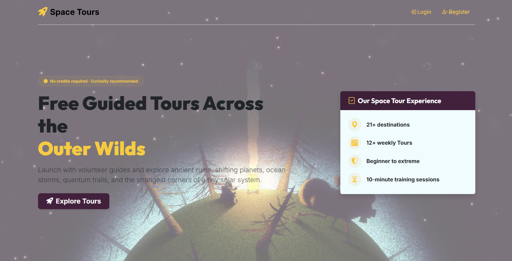
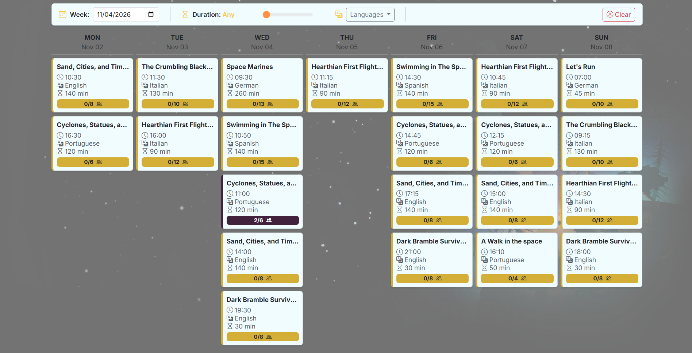
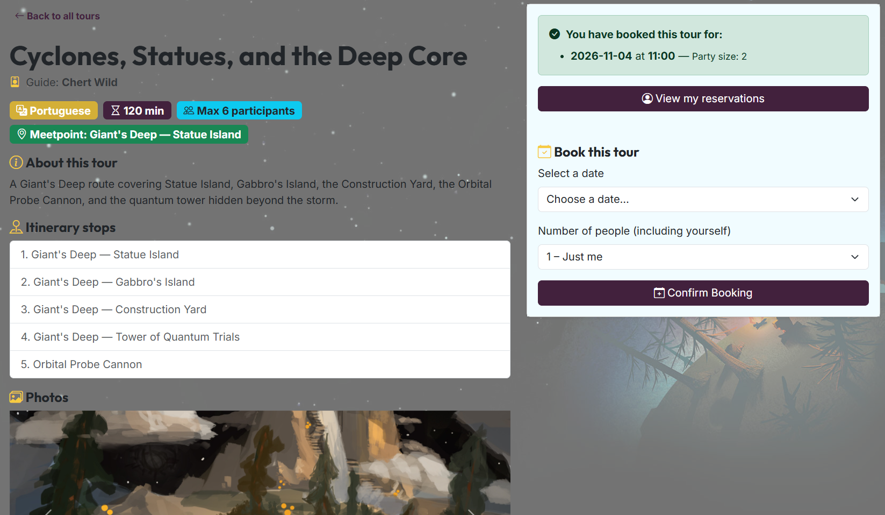
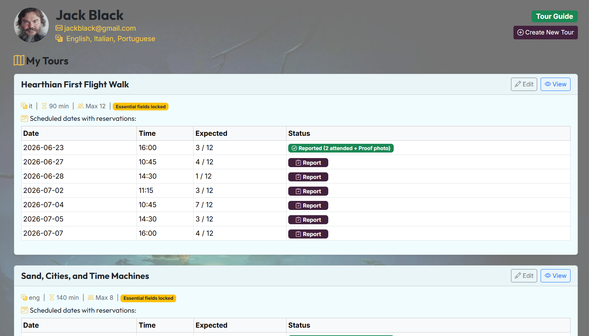
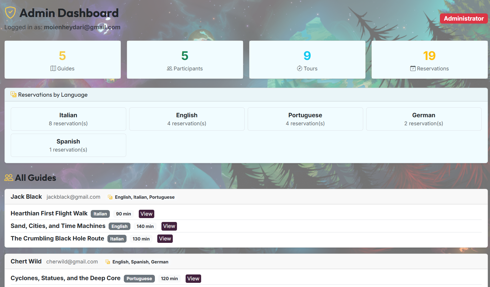

# Space Tours

A Flask web application for discovering and booking guided tours across the
Outer Wilds solar system. Participants can find tours by date, language, and
duration, while guides manage their tours and administrators monitor the
platform.

**Live demo:** [moienheydari.pythonanywhere.com](https://moienheydari.pythonanywhere.com/)

> **Note:** Space Tours is designed for desktop screens. The live demo contains
> sample data for demonstration purposes.

## Features

- Browse a weekly calendar of upcoming tours
- Filter tours by duration and language
- View tour descriptions, meeting points, photos, and itinerary stops
- Book a tour for yourself or a group
- Review and cancel eligible reservations
- Register as a participant or guide
- Create and edit guided tours
- Define tour schedules, capacity, languages, and itinerary stops
- Report completed tours with attendance details and proof photos
- Provide different dashboards and permissions for participants, guides, and
  administrators
- View platform statistics and reservations grouped by language

## Screenshots

### Discover tours





### Book a tour



### Manage tours



### Administration



## Tech stack

- **Backend:** Python, Flask, Flask-Login
- **Database:** SQLite
- **Frontend:** HTML, CSS, and vanilla JavaScript
- **Templating:** Jinja

## Getting started

### Requirements

- Python 3
- `pip`

### Installation

1. Clone the repository and move into the project directory:

   ```bash
   git clone https://github.com/moienheydari/Exam-01.git
   cd Exam-01
   ```

2. Create and activate a virtual environment:

   **Windows PowerShell**

   ```powershell
   python -m venv .venv
   .venv\Scripts\Activate.ps1
   ```

   **macOS/Linux**

   ```bash
   python3 -m venv .venv
   source .venv/bin/activate
   ```

3. Install the dependencies:

   ```bash
   pip install -r requirements.txt
   ```

4. Start the development server:

   ```bash
   python app.py
   ```

5. Open [http://127.0.0.1:5000](http://127.0.0.1:5000) in your browser.

The repository includes a SQLite database at
[`database/space_tours.db`](database/space_tours.db), so the application can be
started with its existing sample data.

## User roles

### Participants

Participants can browse the tour calendar, inspect tour details, make group
reservations, view their bookings, and cancel reservations when the tour starts
more than 24 hours later.

### Guides

Guides can create tours with supported languages, schedules, capacity, meeting
points, itinerary stops, and promotional photos. Once a tour has reservations,
essential details are protected; guides can still update appropriate
descriptive content. After a tour, guides can report attendance and upload
proof.

### Administrators

Administrators can view platform totals, reservation statistics by language,
registered guides, and the tours associated with each guide.

## Project structure

```text
.
├── app.py                 # Flask routes and application entry point
├── database/              # SQLite database and data-access modules
├── docs/screenshots/      # README screenshots
├── ops/                   # Business operations and validators
├── static/                # CSS, JavaScript, and uploaded images
└── templates/             # Jinja HTML templates
```

## Notes

- The application currently targets desktop layouts.
- The included database is intended for local development and demonstration.
- For a production deployment, set a private `SECRET_KEY` and use deployment
  environment configuration instead of development defaults.
